<p align="center">
  <picture>
    <source media="(prefers-color-scheme: dark)" srcset="assets/brand/audivane-logo-dark.svg">
    
  </picture>
</p>

<h3 align="center">High-performance upsampling with inspectable filters, and realistic harmonic distortion modelling.</h3>

<p align="center">
  Measured harmonics, EQ and convolution too, system-wide in 64-bit float, on Linux with PipeWire.
</p>

<p align="center">
  <a href="#install"><b>Install</b></a>&nbsp;&nbsp;&nbsp;
  <a href="https://audivane.app/dsp/">Website</a>&nbsp;&nbsp;&nbsp;
  <a href="https://audivane.app/docs/dsp/">Setup guide</a>&nbsp;&nbsp;&nbsp;
  <a href="docs/architecture.md">Architecture</a>
</p>

<p align="center">
  <picture>
    <source media="(prefers-color-scheme: dark)" srcset="docs/images/app-dark.webp">
    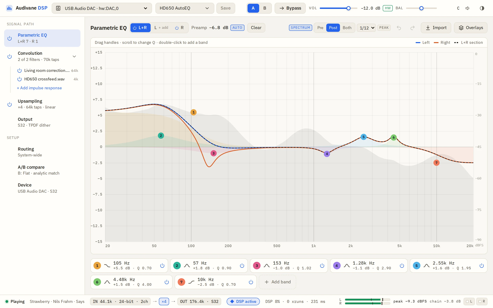
  </picture>
</p>

Version 0.11.0. Packages for Arch, Debian / Ubuntu and Fedora, and an
AppImage. Free and open source.

## Upsampling

Integer ratios up to ×64, fractional (44.1 to 48 kHz) and decimating (192 to
48 kHz), up to 3.072 MHz, with filters of 1 to 8.4M taps.

Long filters are cheap to run. 8M taps at ×16 from 44.1 kHz takes about 6 % of
a core on our test machine, down from 110 % in 0.10, and 44.1 kHz music costs
about the same as 48 kHz.

- **Recommended** upsamples to the highest rate in your music's family, up to
  768 kHz. The filter is flat to 20 kHz and fully stops at Nyquist.
- **Presets:** 68 of them, from Gaussian, flat-top, Chebyshev and Kaiser
  windowed sincs to half-band, ×2/×3 cascades, short interpolators, block FFT
  and NOS. You can pick linear, minimum or intermediate phase.
- **Custom:** design your own filter or start from a preset, and hear changes
  as you edit. Pick a window (Kaiser, DPSS and more), or an equiripple or
  least-squares design, and set where the passband ends in Hz or stop it at
  Nyquist.
- **Inspectable filters:** you can inspect the filter response, the transition
  band, impulse, and hardware usage at each source rate.
- **Per-rate fallback:** if a filter is too heavy for one sample rate, music at
  that rate gets a lighter one. The app tells you why and offers a fix.

The preset families:

| Family | Trade-off |
| --- | --- |
| Gaussian | Smooth roll-off, no ringing at one frequency. |
| Flat-top | Sidelobes at −196 to −248 dB, slower transition. |
| Chebyshev | Short, with an even −193 dB stopband floor. |
| Kaiser | Wide passband, or compact with a cutoff that follows the rate. |
| Half-band, Hann | Cutoff at Nyquist; every input sample is kept. |
| Lanczos, Nuttall | Short and light, little ringing, early roll-off. |
| Short leaky | Short, early roll-off, lets some images through. |
| Cascades | ×2 and ×3 stages: FIR, FFT, elliptic or inverse Chebyshev. |
| Interpolators, block FFT | Near-zero CPU and delay, or a brick wall per block. |
| NOS | Zero-order hold: each sample repeated, at integer ratios. |

<p align="center">
  <picture>
    <source media="(prefers-color-scheme: dark)" srcset="docs/images/upsampling-dark.webp">
    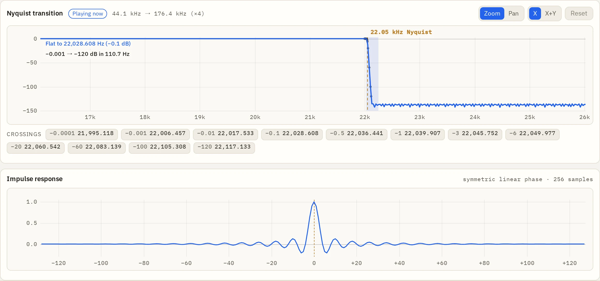
  </picture>
</p>

<p align="center">
  <picture>
    <source media="(prefers-color-scheme: dark)" srcset="docs/images/upsampling-plots-dark.webp">
    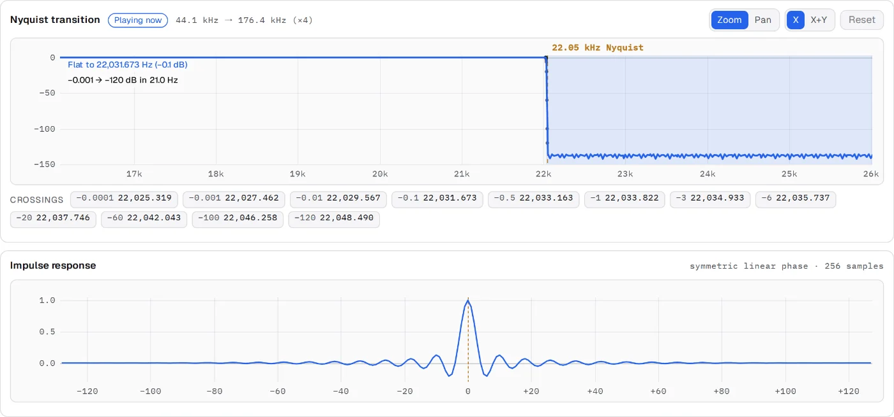
  </picture><br><sub>The measured transition and impulse of the filter above.</sub>
</p>

## Harmonics

Harmonic distortion modelled on tubes, transformers and tape. Chain layers in
series, the way stages follow each other in an amplifier, or mix them in
parallel, and edit each one.

- **Harmonic layers:** set H2 to H9 in each layer, each with its own level and
  sign, and flip all the even orders at once. Drive sets how hard the signal
  hits the curve; amount scales the layer.
- **Against frequency:** make the harmonics rise toward the bass or the
  treble. By default only odd orders rise in the bass, like a saturating core.
  You can also set each order by hand to match a measured device.
- **Under load:** sag lowers the drive on loud passages, and bias shift moves
  the even/odd balance. Both have attack, release and depth.
- **Transformer and tape:** a transformer layer saturates more in the bass, and
  tape hysteresis comes with presets fitted to measured tape machines.
- **Presets:** 15 layer presets and 9 full systems, from a single-ended triode
  amp to tape played back on tubes, and you can edit any of them.
- **Graphs and readouts:** the spectrum, and THD and each harmonic against
  level and frequency, with THD+N and the GedLee metric. Harmonics that fold
  back above Nyquist show as aliasing, not THD. The graphs can follow the
  music.
- **On the music:** you can also see what harmonics are added to the music and
  how, including the even/odd split and the sag over time. That's rarely the
  1 kHz THD a spec sheet gives.

<p align="center">
  <picture>
    <source media="(prefers-color-scheme: dark)" srcset="docs/images/harmonics-dark.webp">
    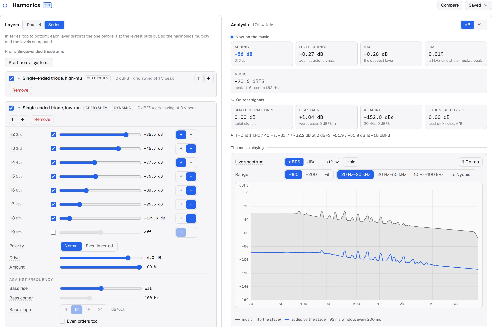
  </picture>
</p>

<table>
<tr>
<td width="50%" align="center"><picture>
    <source media="(prefers-color-scheme: dark)" srcset="docs/images/harm-live-dark.webp">
    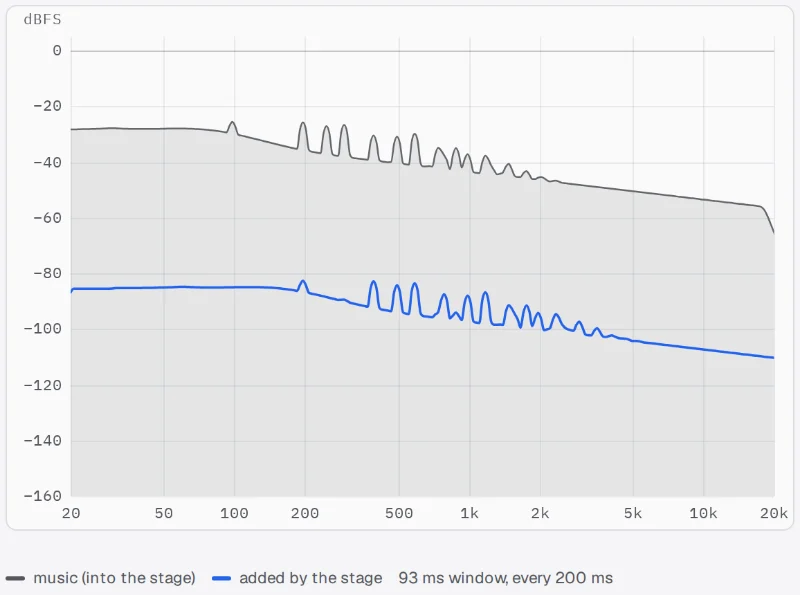
  </picture><br><sub>What the harmonics add to the music.</sub></td>
<td width="50%" align="center"><picture>
    <source media="(prefers-color-scheme: dark)" srcset="docs/images/harm-history-dark.webp">
    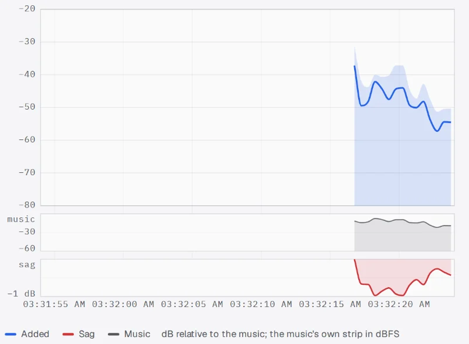
  </picture><br><sub>Added level over the last 30 seconds.</sub></td>
</tr>
</table>

<p align="center">
  <picture>
    <source media="(prefers-color-scheme: dark)" srcset="docs/images/harm-spectrum-dark.webp">
    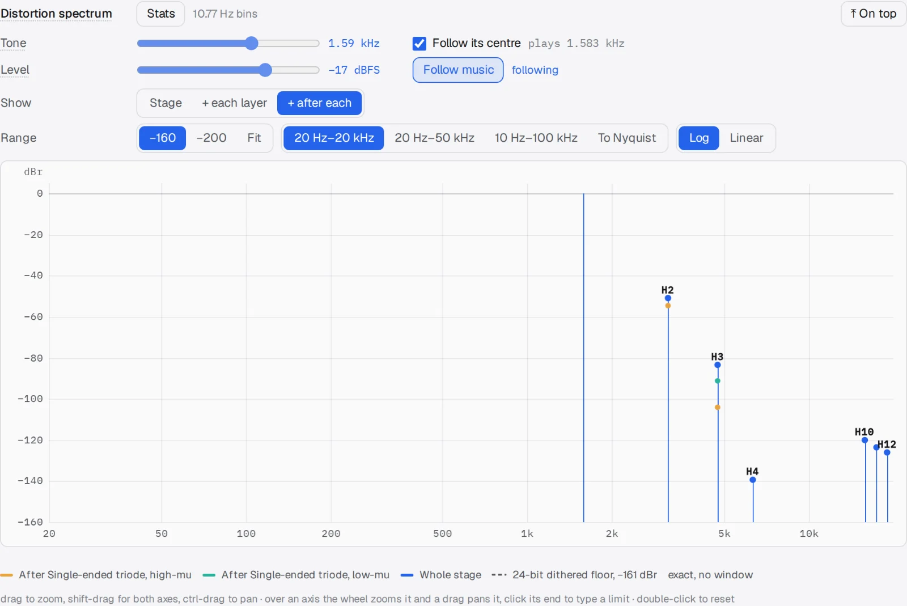
  </picture><br><sub>Spectrum of a test tone that follows the music, after each layer.</sub>
</p>

<p align="center">
  <picture>
    <source media="(prefers-color-scheme: dark)" srcset="docs/images/harm-level-dark.webp">
    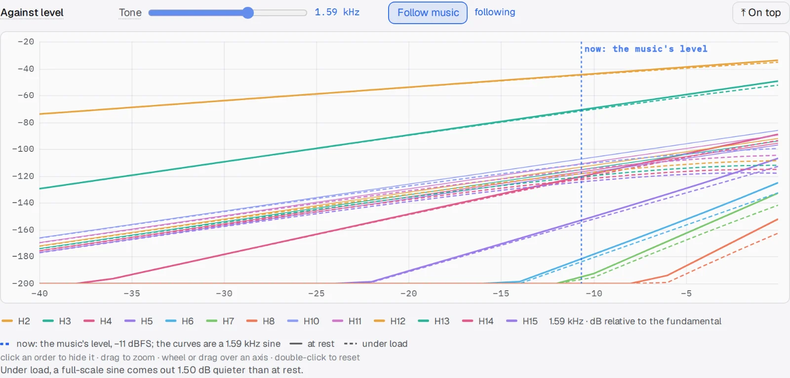
  </picture><br><sub>Each harmonic against level, at the music's level now.</sub>
</p>

<p align="center">
  <picture>
    <source media="(prefers-color-scheme: dark)" srcset="docs/images/harm-freq-dark.webp">
    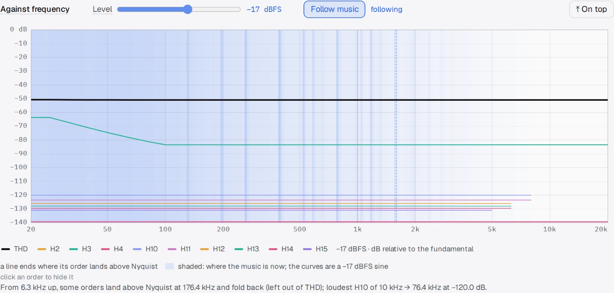
  </picture><br><sub>THD and each harmonic against frequency, where the music is now.</sub>
</p>

Each layer can also show what it does to a sine. These are from the triode amp and a tape layer:

<table>
<tr>
<td width="50%" align="center"><picture>
    <source media="(prefers-color-scheme: dark)" srcset="docs/images/harm-transfer-dark.webp">
    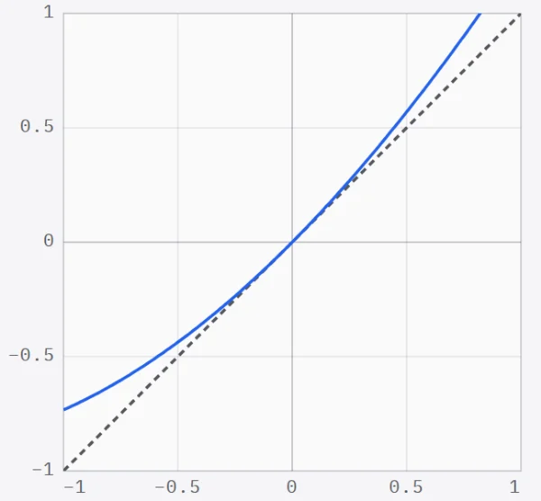
  </picture><br><sub>The layer's curve, bend shown 10× deeper.</sub></td>
<td width="50%" align="center"><picture>
    <source media="(prefers-color-scheme: dark)" srcset="docs/images/harm-flux-dark.webp">
    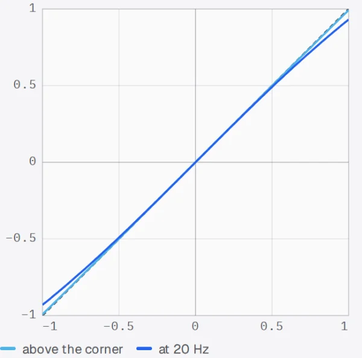
  </picture><br><sub>Transformer curve in the bass and above.</sub></td>
</tr>
<tr>
<td width="50%" align="center"><picture>
    <source media="(prefers-color-scheme: dark)" srcset="docs/images/harm-tape-dark.webp">
    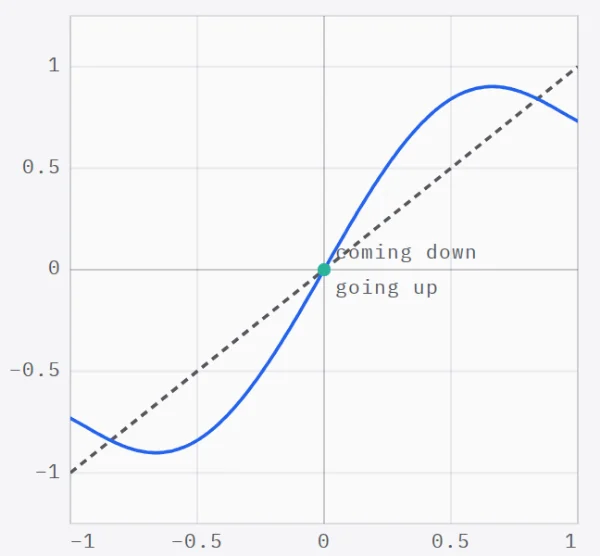
  </picture><br><sub>Tape hysteresis loop.</sub></td>
<td width="50%" align="center"><picture>
    <source media="(prefers-color-scheme: dark)" srcset="docs/images/harm-sag-dark.webp">
    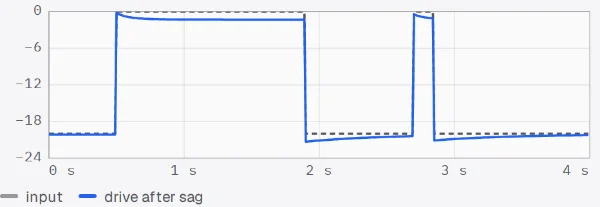
  </picture><br><sub>Sag lowers the drive on loud passages.</sub></td>
</tr>
</table>

## Stereo image

- **Crossfeed** sends some of each channel to the other ear in the bass, like
  speakers in a room. Pick one of four published designs or set your own
  cutoff and level. It keeps typical stereo at the same loudness.
- **Width** narrows the image down to mono or makes it up to twice as wide,
  everywhere or only above the bass. It never changes mono music, and it isn't
  level-compensated: one step wider is 0.6 dB louder.

<p align="center">
  <picture>
    <source media="(prefers-color-scheme: dark)" srcset="docs/images/stereo-image-dark.webp">
    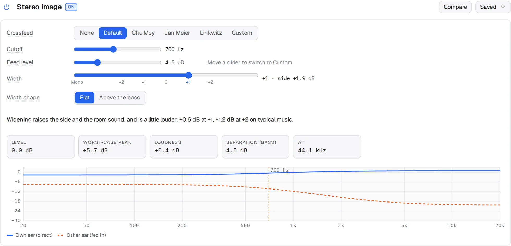
  </picture>
</p>

## Pitch, speed and tempo

- **Pitch shift** changes the pitch without changing the tempo, up to an octave
  either way, in cents, semitones or from one tuning to another (440 to
  432 Hz). Quality Low, High (120 ms delay) or Max (240 ms); at high sample
  rates the app steps down a level to keep up.
- **Varispeed** changes speed and pitch together, like a turntable's speed
  control, from half to double speed. Keep pitch changes only the tempo, with
  about 135 ms of delay, up to 96 kHz.

<p align="center">
  <picture>
    <source media="(prefers-color-scheme: dark)" srcset="docs/images/pitch-dark.webp">
    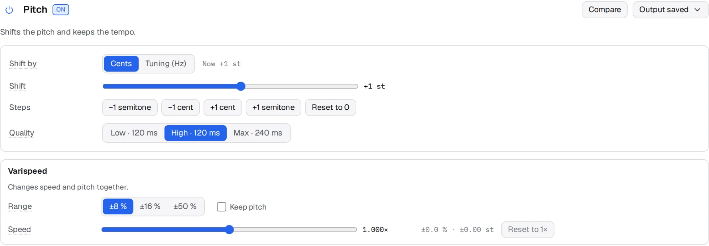
  </picture>
</p>

## A/B and blind tests

Compare any two settings at matched loudness, then run a blind ABX, A/B or
preference test. Level matching is K-weighted and never boosts. The number of
trials is fixed before you start, and the result comes with a p-value and a
commitment you can verify afterwards.

<p align="center">
  <picture>
    <source media="(prefers-color-scheme: dark)" srcset="docs/images/blind-test-dark.webp">
    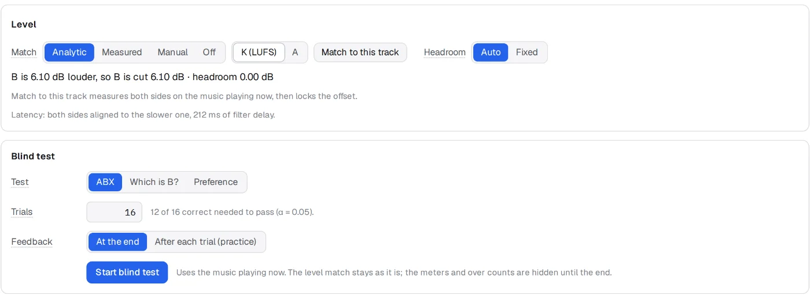
  </picture>
</p>

## One processor for the whole system

The engine opens your DAC directly over ALSA and runs PipeWire on its clock,
in 64-bit float, so nothing resamples behind your back. It follows the rate of
what you play, and you can change every stage live in the app.

| | |
| --- | --- |
| **Two outputs** | A DSP sink for the whole system (or only the apps you pick), and *Audivane Direct*, a bit-perfect sink for your music player |
| **Parametric EQ** | L+R, L and R sections; peaking, shelf, pass, band-pass, notch and all-pass bands; bass, treble and tilt; AutoEQ and Equalizer APO import; target and measurement overlays |
| **Convolution** | WAV impulse responses for room correction or crossfeed, or a FIR matrix (each output a sum of filtered inputs); response plot, boost cap and clip warnings |
| **A/B and blind tests** | Compare any two settings at matched loudness (K-weighted, never boosts), or run blind ABX, blind A/B and preference tests with a p-value and a verifiable commitment |
| **Output** | Headroom against inter-sample overs, a true-peak limiter, 11 dither modes (TPDF and noise-shaped), S16/S24/S32 |
| **More stages** | DC blocker, stereo image, pitch and varispeed |
| **Also play on** | Up to three more DACs in sync, even identical models |
| **Presets** | Whole-chain presets, and presets for each page |
| **Volume and desktop** | Software, hardware or hybrid volume; tray, volume keys, start at login |
| **Under load** | If the chain can't keep up, it switches to a lighter one instead of crackling |
| **Monitoring** | Level meters, pre/post spectrum, streams and DSP load in the status bar |

## Install

64-bit Linux with PipeWire and WirePlumber. Everything is on
[Releases](https://github.com/audivane/dsp/releases/latest) with SHA-256 checksums.

The AppImage runs on any distribution, without root (it needs WebKitGTK 4.1
from your distribution, which most desktops already have):

```sh
curl -fLO https://github.com/audivane/dsp/releases/download/0.11.0/Audivane-DSP-0.11.0-x86_64.AppImage
chmod +x Audivane-DSP-0.11.0-x86_64.AppImage && ./Audivane-DSP-0.11.0-x86_64.AppImage
```

The app opens and offers **Set up and start**: it installs the engine, the app
and `avdsp` for your user under `~/.local` (with the engine's user service and
a menu entry) and starts the engine. Opening a newer AppImage later updates
that install the same way a package upgrade does; `--uninstall` (add `--purge`
to delete the settings too) removes it.

Or install the package for your distribution:

```sh
# Arch Linux
curl -fLO https://github.com/audivane/dsp/releases/download/0.11.0/audivane-dsp-0.11.0-1-x86_64.pkg.tar.zst
sudo pacman -U ./audivane-dsp-0.11.0-1-x86_64.pkg.tar.zst

# Ubuntu 24.04+ / Debian 13+
curl -fLO https://github.com/audivane/dsp/releases/download/0.11.0/audivane-dsp_0.11.0-1_amd64.deb
sudo apt install ./audivane-dsp_0.11.0-1_amd64.deb

# Fedora 40+
sudo dnf install https://github.com/audivane/dsp/releases/download/0.11.0/audivane-dsp-0.11.0-1.x86_64.rpm
```

With a package, start the engine for your user and open **Audivane DSP** from your app menu:

```sh
systemctl --user daemon-reload
systemctl --user enable --now audivane-dsp
```

While it runs, the engine uses your DAC exclusively;
`systemctl --user disable --now audivane-dsp` hands it back. The
[setup guide](https://audivane.app/docs/dsp/) covers choosing the DAC,
routing and troubleshooting.

### Update

```sh
avdsp upgrade            # shows the installed and latest versions and the release notes, asks, then updates
avdsp upgrade --check    # only report: exit 0 when up to date, 10 when an update exists
```

Run it as your normal user: it downloads the package for your distribution
into `~/.cache/audivane-dsp/upgrade`, checks its SHA-256 against the release's
`SHA256SUMS`, installs it with `sudo pacman -U` / `sudo apt install` /
`sudo dnf install`, restarts the engine if it was running and confirms the new
version. `--yes` skips the question; `--version <tag>` installs a given release
(also to reinstall or go back). Installing a newer package by hand works too:
the package restarts every running engine, and a running app restarts itself
into its new version (if it cannot, its window and tray offer a **Restart**).

Development runs on Arch with PipeWire 1.6; the
Ubuntu and Fedora packages and the AppImage are built and install-tested on
every release but get less day-to-day use. Bug reports are very welcome.

## Build from source

Rust (stable), Node 22+, clang, and the development packages for PipeWire
(1.0+), ALSA, GTK 3, WebKitGTK 4.1 and D-Bus. The exact
package list is in [DEV.md](DEV.md#build-from-source).

```sh
git clone https://github.com/audivane/dsp.git && cd dsp
(cd app && npm ci && npm run build)
cargo build --release -p audivane-dsp-daemon -p audivane-dsp-cli
cargo build --profile release-ui -p audivane-dsp-ui --features custom-protocol
```

## Repository

| Path | What |
| --- | --- |
| `crates/` | `protocol`, `dsp-core`, `io-alsa`, `io-pw`, `daemon` (`audivane-dsp`), `cli` (`avdsp`) |
| `app/` | Desktop app (Tauri 2 + React) |
| `packaging/` | systemd user unit, release pipeline (`.deb`, `.rpm`, Arch, AppImage) and `PKGBUILD` |
| `docs/` | [Architecture](docs/architecture.md), [control plane](docs/control-plane.md), [PipeWire driver](docs/pipewire-driver.md) |

## Contributing

Bug reports and pull requests are welcome; please read
[CONTRIBUTING.md](CONTRIBUTING.md). Pull requests need a one-time
[Contributor License Agreement](CLA.md), which a bot will ask you to sign.

## License

Copyright © 2026 Triet ([@Triet1402](https://github.com/Triet1402)).
Audivane DSP is free software under the
[GNU Affero General Public License v3.0 only](LICENSE). Third-party crates and
packages keep their own licenses, listed in
[`THIRD_PARTY_LICENSES.txt`](packaging/THIRD_PARTY_LICENSES.txt). The bundled
fonts (a Geist subset and renamed IBM Plex Mono subsets) are under the SIL
OFL 1.1 ([font licensing](docs/font-licensing.md)), and the target curves are
documented in the `SOURCES.md` files under [`app/src/assets/`](app/src/assets).
